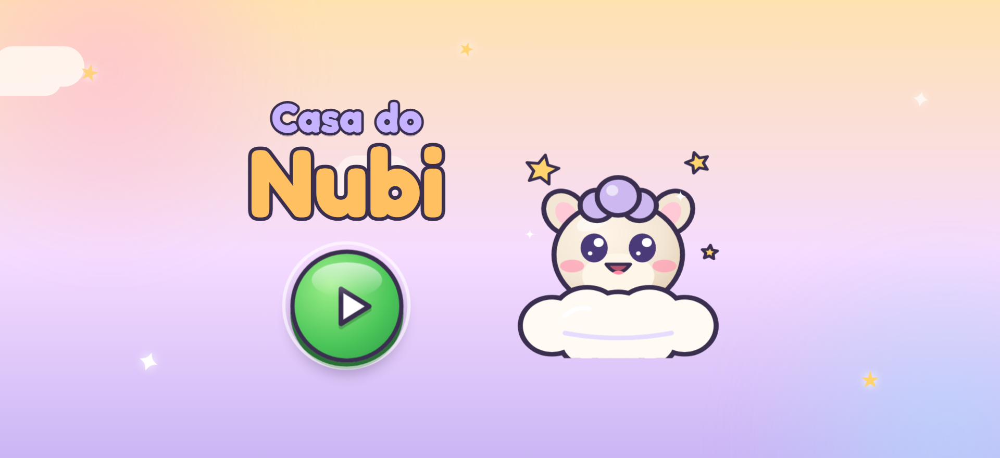
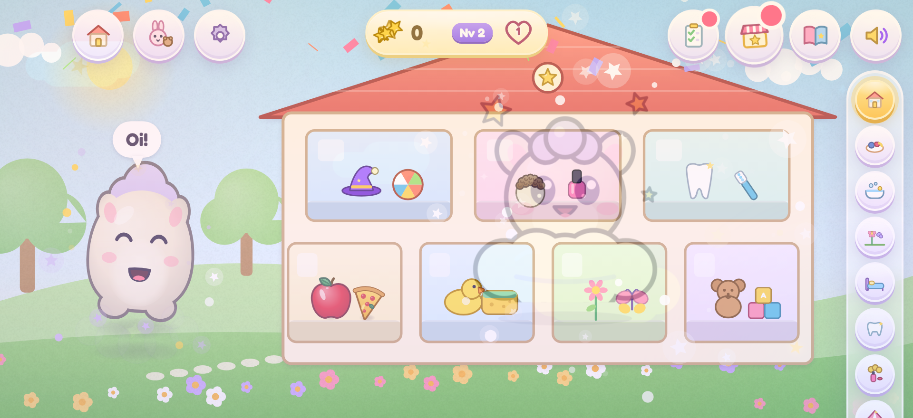
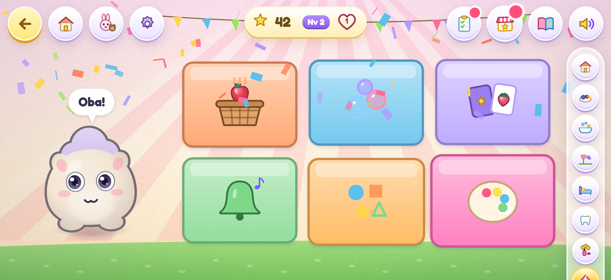
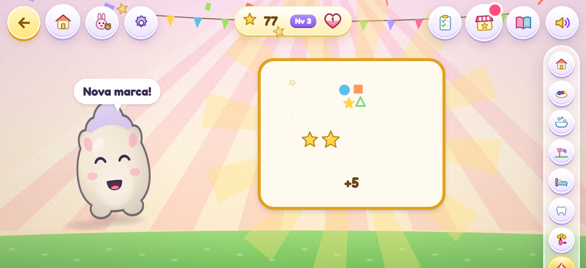
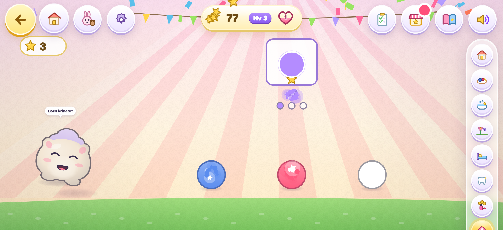
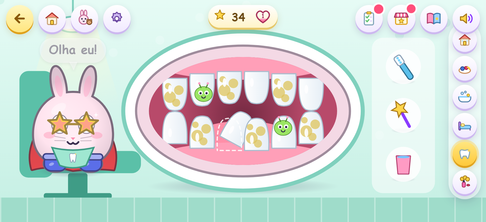
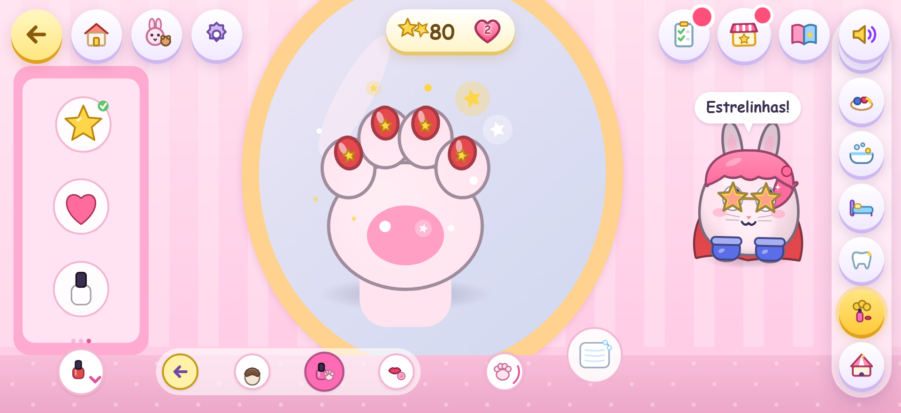

# Casa do Nubi


Ícones (PWA e Android) são gerados de um único desenho em `scripts/make-icons.cjs`
(precisa de Playwright: `NODE_PATH=<node_modules com playwright> node scripts/make-icons.cjs`).

Jogo 2D offline para crianças de 4 anos ou mais. A criança brinca com um
bichinho (Nubi, a coelhinha Lili ou o ursinho Tito) manipulando objetos pela
casa. O centro do jogo é descobrir como o bichinho reage, com pedidos que
orientam sem pressionar.

- HTML5 Canvas + JavaScript (ES modules), sem dependências de runtime; som
  gerado com Web Audio. APK Android via Capacitor 6.
- Paisagem, um dedo, sem leitura obrigatória, sem anúncios, compras, contas,
  backend ou coleta de dados. Tudo salvo só no aparelho (localStorage).
- Toda ação aceita dois jeitos: arrastar o objeto **ou** tocar nele e depois no
  destino.
- Abre direto numa tela inicial animada com botão Play. No Android o app fica
  sempre em paisagem; num navegador com o celular em pé o jogo se gira sozinho.
- Tela inteira: o APK esconde as barras do Android (modo imersivo) e desenha
  até o recorte da câmera (`android-src/MainActivity.java`, copiado pelo build).
  No navegador do celular o Play pede tela cheia, e se a criança sair dela o
  próximo toque pede de novo (`src/core/fullscreen.js`).
- Responsivo: o tamanho vem da área visível real (não do `100vh`, que no
  celular conta a barra do navegador). Os botões se ajustam à altura da tela
  e respeitam o recorte da câmera.

## Telas

| | |
|---|---|
|  |  |
| Tela inicial com Play | Mapa da casa com 7 cômodos |
|  |  |
| Quarto de Brinquedos: 6 minijogos | Jardim: regar e colher |
|  |  |
| Minijogo Formas (encaixar) | Minijogo Cores (misturar) |
|  |  |
| Consultório dos dentinhos | Salão: estação de unhas |

## Como rodar

**Navegador** (precisa só de Python 3; ES modules não abrem por `file://`):

```bash
python -m http.server 8000 --bind 127.0.0.1
# abra http://127.0.0.1:8000 em paisagem (DevTools > modo celular, se quiser)
```

Para recomeçar do zero: `localStorage.clear()` no console e recarregar.

**Testes** (Node 20+ e Python; instala o Playwright numa pasta temporária):

```powershell
powershell -ExecutionPolicy Bypass -File test\verify.ps1            # todas as suítes
powershell -ExecutionPolicy Bypass -File test\verify.ps1 features   # uma só
```

**APK** (Linux/WSL com JDK 17, Node 20+ e Android SDK em `~/android-sdk`):

```bash
bash scripts/build-apk.sh
adb install -r nubi-casa-magica-debug.apk     # aparelho com depuração USB
```

O APK gerado é **debug** (assinado com a chave de debug), bom para testar, não
para a loja.

## O que tem no jogo

| Espaço | Brincadeiras |
|---|---|
| Mapa da casa | tela principal (depois da primeira visita): a casa em corte, com os **7 cômodos** como janelas; um toque entra; o cômodo do pedido brilha com uma estrela; enfeites ganhos na lojinha aparecem aqui; às vezes um balão-surpresa com presente sobe pelo jardim |
| Quarto de Brinquedos | **6 minijogos** curtos: **Pega-frutas**, **Estoura-bolhas**, **Memória** (3 a 6 pares), **Música** (repetir a melodia, com 5 instrumentos: sino, xilofone, piano, violão, tambor), **Formas** (arrastar cada forma para o furo certo) e **Cores** (misturar duas tintas até a cor-alvo); toda partida termina em festa e dá estrelinhas, com "nova marca!" pessoal |
| Jardim | regar os canteiros (crescem em 3 passos até florir), colher a fruta madura (vai "para a cozinha" e dá estrelinhas) e borboletas que reagem ao toque |
| Cozinha | 20 comidas em 5 abas (frutas, mais frutas, salgados, doces e bebidas, especiais), cada uma com reação própria; cascas vão para a lixeira; saquinho cheio sai pela janela e o caminhão do lixo passa |
| Banheiro | esponja (espuma, lavar as orelhas), chuveirinho, toalha, patinho, pente (pelo brilhando); cocô estilizado vai para o vaso com descarga |
| Quarto | guarda-roupa com 10 páginas: 27 peças em 6 espaços, 6 looks prontos e presentes; bola e cesto; varal de conquistas |
| Consultório dos dentinhos | escovar placas, espantar "bichinhos de açúcar" com a varinha, encaixar o dente torto, enxaguar; sorriso brilhante no fim |
| Salão de beleza | recepção com 3 portas: **Cabelo**, **Unhas** (close da patinha, dedinho por dedinho, adesivinhos de estrela/coração) e **Maquiagem** (rosto em destaque); fileira embaixo com voltar e atalhos entre estações; 5 penteados, 5 cores, enfeites, esmalte por patinha, maquiagem leve, pinturas de rosto (bigode, herói, estrelas, sardas, barba); lencinho limpa |

**Bichinhos:** vitrine no canto superior. Cada um guarda a própria aparência
(cor, roupas, beleza); o progresso dos capítulos é da criança e vale para todos.
Nenhuma opção é travada por gênero.

**Capítulos e pedidos:** o bichinho mostra num balão de pensamento o que quer
(desenho, sem texto). Temporada 1: recepção, cozinha, banho, desfile, bola e
festa. Temporada 2: novos amigos, looks, dentista, rotina de limpeza e salão.
Depois disso vêm pedidos livres. Pedido é convite: nada é bloqueado e ignorar
não custa nada.
- O capítulo segue a criança: entrou no salão, o pedido vira o do salão.
- Ajuda por inatividade em degraus: olhar do bichinho -> objeto pula -> mãozinha.
- Modos dos responsáveis (Explorar / Experimentar / Resolver) mudam os pedidos e
  a paciência da ajuda.
- **Área dos responsáveis:** fica pequenininha dentro da mochila. Para abrir,
  segure o botão por 3s e depois arraste a bolinha até o número escrito por
  extenso ("Arraste a bolinha até o número sete", entre 6 números
  sorteados; tocar no número também vale). Quem ainda não lê não sabe qual
  escolher; a voz do jogo não lê essa tela. Errar fecha; 3 erros seguidos
  travam por 30s. Não é comprovação de idade e nunca pede idade.

**HUD enxuto (3 coisas na tela):** a **casa** (mapa) no canto esquerdo, as
**estrelinhas** no centro e a **mochila** no canto direito. O mapa é a
navegação: a casa pulsa quando o pedido é em outro cômodo. A mochila guarda
bichinhos, missões, prêmios, álbum, som e, pequenininha no canto, a área dos
responsáveis; o botão dela repete os sinais de dentro (pontinho de prêmio ou
baú pronto, pulso de pedido, pulinho de adesivo novo).
- **Voltar** só aparece em sub-telas (estação do salão) e sai delas.
- **Minijogo:** o HUD some e fica só a **pausa**, que congela a partida e
  oferece continuar (grande, verde) ou sair. Nada de sair sem querer. O jogo
  também pausa sozinho quando o app vai para o segundo plano.
- **Fim de partida:** além da festa, dois botões grandes: **de novo** (mesmo
  jogo) e **outro jogo** (cartões).
- Esc/Backspace no computador: fecham o que estiver aberto, pausam o
  minijogo, saem da sub-tela ou vão para o mapa.

**Estrelinhas (temporada 3):** só sobem: nunca se perdem nem se gastam, e não
existe errar. Brincar dá 1 (a mesma ação seguida não conta de novo por 2,5s),
cada pedido 2, cada capítulo 5, cada missão do dia 5.
- **Pote de estrelinhas (sem números):** no topo, um pote que enche até o
  próximo presente, o desenho do próximo presente e o coração de carinho. As
  estrelinhas voam até o pote; quando ele enche, **um presente aparece ao lado
  do bichinho**, no cômodo: 2 toques balançam, o 3º abre e o prêmio pula para
  fora (comida especial na geladeira, roupa no guarda-roupa, enfeite na casa).
  Presente sem abrir continua esperando (inclusive depois de fechar o jogo);
  no minijogo ele some e volta depois. Depois dos 12 prêmios, a cada 30
  estrelinhas vem um presente-festa. Cada presente é um "nível".
- **Coleção de prêmios** (na mochila): 12 prêmios (comidas especiais, roupas,
  enfeites da casa), sem preços: ganho (cor e ✓), pronto (brilha), a ganhar
  (silhueta); o próximo mostra a barrinha do pote. Nada do jogo básico fica
  trancado. Os números (estrelinhas, presentes, preço do próximo) ficam no
  relatório dos responsáveis.
- **Carinho:** coração por bichinho que enche com cuidados; cada nível tem festa.
- **Missões do dia:** 3 sugestões que trocam pela data (sempre uma delas é um
  minijogo), sem sequência nem cobrança; tocar numa missão leva até o cômodo dela.

**Brincadeiras e recompensas do dia (temporada 4):**
- Cada partida dá de 3 a 12 estrelinhas (nunca zero: não existe perder). Fruta
  que cai no chão e erro na memória ou na música não tiram nada; na música, errar
  só faz o bichinho tocar a melodia de novo.
- Recorde só pessoal ("nova marca!"), sem ranking. Cada minijogo vira um cartão
  no álbum e o capítulo "Brincadeiras" pede os jogos.
- **Baú do dia:** abre com as 3 missões feitas (+10). **Presente do dia:** um
  presentinho pula no canto na primeira abertura de cada dia (+5), sem modal.
  **Surpresa:** balão com presente no mapa em metade das visitas (+3).
- Som: timbres em camadas com eco leve e uma musiquinha de fundo diferente por
  cômodo; cada canal pode ser desligado na área dos responsáveis.
- **Voz (sem leitura obrigatória):** o bichinho fala em voz alta os balões
  (reações e elogios), o pedido quando o balão de pensamento aparece (e de
  novo na ajuda por inatividade), o nome do cômodo ao entrar e "Vamos para
  o banheiro?" quando o pedido é em outro cômodo. Tocar no balão repete o
  pedido. Pedidos ficam em silêncio nos minijogos, a música abaixa enquanto
  ele fala e cada bichinho tem um tom. A voz vem de uma gravação em
  `assets/voice/<id>.mp3`, se existir; senão do aparelho (APK, plugin
  `@capacitor-community/text-to-speech`) ou do navegador (pt-BR, preferindo
  voz que funciona sem internet). Desligar "falas" na área dos responsáveis
  (ou o botão de som) silencia.
  - **Gravar a voz:** `node scripts/voice-lines.mjs > falas.csv` lista as
    ~210 falas (`id;texto`). Grave cada uma em `assets/voice/<id>.mp3` e
    inclua o id em `RECORDED` (`src/data/voice_lines.js`); as que faltarem
    continuam com a voz sintetizada.

**Dificuldade que acompanha a criança:** cada minijogo tem degraus
(Memória de 2 a 6 pares, Música de 3 a 7 notas, Formas de 2 a 5, Cores de 2
a 5 misturas, Pega-frutas e Estoura-bolhas no ritmo e no tamanho). Começa no
degrau de antes (Explorar), sobe depois de 2 partidas seguidas com 85% de
acerto ou mais e desce depois de 2 abaixo de 60%; sair no meio não conta. O
modo dos responsáveis só define até onde sobe. Nada disso aparece para a
criança; o relatório dos responsáveis mostra degrau, acerto médio e partidas
por minijogo. Na Música, 5 notas erradas encerram a partida em festa (a
criança não fica presa).

**Capítulos sem pressão:** além das estrelinhas, nada de porcentagem, sequência diária ou
recompensa aleatória. Cada capítulo concluído dá um adesivo (álbum + varal) e
um **presente fixo** para o guarda-roupa (óculos de estrela, coroa de ouro,
botas brilhantes, capa arco-íris, medalha, chifre de unicórnio, asas de fada).
O presente é sempre o mesmo pelo mesmo capítulo e nunca se perde.

**Novidades da v1.1:**
- **Nível do jogador:** virou o pote de estrelinhas (cada presente aberto é
  um nível). É só progressão por brincar, nunca perde.
- **Conquistas (troféus):** marcos divertidos (primeira estrelinha, três presentes,
  melhor amigo, brincalhão, jardineiro...) aparecem no álbum. Sem punição.
- **Área dos responsáveis ampliada:** relatório dos últimos dias (tempo de jogo,
  cuidados e brincadeiras) e um **limite de tempo opcional** - ao atingir, o
  Nubi vai dormir com carinho, sem bloqueio brusco nem aviso de culpa.
- **Design mais moderno:** cenários com mais volume e luz, fonte arredondada
  (Fredoka), microanimações.

## Arquitetura

```
src/
  main.js                  bootstrap: bichinho, cômodos, sistemas, loop
  core/                    eventos, viewport, input (1 dedo), cenas, animação
  entities/nubi.js         personagem (espécie, estado, aparência, animação)
  entities/wear.js         pintores de roupas e beleza (personagem e ícones)
  entities/food_item.js    alimento arrastável (arte em food_art.js)
  scenes/*_room.js         mapa, cozinha, banheiro, jardim, quarto, dentista,
                           salão, quarto de brinquedos (games_room.js)
  systems/                 efeitos, áudio, voz, save, pedidos/capítulos (quests),
                           estrelinhas/prêmios/missões (progress)
  data/                    alimentos, capítulos, bichinhos, guarda-roupa, salão,
                           prêmios
  ui/                      tela inicial, guia (balão, dicas, presentes), álbum,
                           vitrine, lojinha/missões, ícones, responsáveis
test/                      11 suítes Playwright + verify.ps1
scripts/build-apk.sh       build do APK (paisagem, ícone e nome aplicados)
```

Tudo é dirigido por dados: uma peça nova é uma entrada em `data/wardrobe.js`;
um penteado ou esmalte novo, em `data/salon.js`; um capítulo, em
`data/chapters.js`.

## Testes

`play`, `stage2`, `mvp`, `visual`, `quests`, `features`, `growth`, `title`,
`games`, `garden`, `voice`, `parent`, `skill` e `gift` (Playwright headless, interações reais de ponteiro). `games`
joga os 6 minijogos de verdade (arrastar, estourar, virar cartas, tocar
sininhos, encaixar formas, misturar cores), o voltar no meio da partida, a
surpresa do mapa, o baú e o presente do dia. `garden` rega e colhe no jardim.
`growth` cobre o nível do jogador e as conquistas. `features` cobre a vitrine e
a aparência por bichinho, páginas do guarda-roupa, looks, presente de capítulo,
o dentista completo, lixo/caminhão/cocô/pente e o salão com persistência após
recarregar. Capturas em `previews/`.

**Não testado:** desempenho em celular real e teste com crianças. Os ~60 FPS
foram medidos no Chromium headless de um PC.

## Arte

Toda a arte é procedural (desenhada em código) e a voz é sintetizada (do
aparelho ou do navegador) até haver gravações: é arte de protótipo
caprichada, não arte final.
